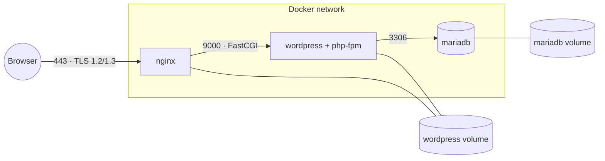

*This project has been created as part of the 42 curriculum by srosu.*
 
# Inception
 
## Description
 
Inception is a system administration project from the 42 curriculum. The goal is to set up a small web infrastructure inside a virtual machine, using Docker Compose, where every service runs in its own container.
 
The stack is made of three services:
 
| Service | Role | Internal port |
| --- | --- | --- |
| **nginx** | Only entrypoint of the infrastructure, HTTPS only (TLS 1.2 / 1.3) | 443 (published) |
| **wordpress** | WordPress served by php-fpm, without a web server | 9000 |
| **mariadb** | Database of the WordPress website | 3306 |
 
Each image is built from our own Dockerfile on top of **Debian 12 (bookworm)**, the penultimate stable Debian release. No ready-made image is pulled.
 

 
---
 
## Instructions
 
### Prerequisites
 
- A Linux virtual machine with `make`, Docker and Docker Compose installed.
- Permission to use Docker: either `sudo`, or membership of the `docker` group:
```bash
sudo usermod -aG docker <user>
```
 
Then log out and back in for the change to apply.
 
### Configuration
 
1. Create the secret files in `secrets/` (database password, database root password, credentials).
2. Create `srcs/.env` with the non-confidential variables (domain name, database name and user, etc.).
3. Make the domain name point to your local machine by adding this line to `/etc/hosts`:
```text
127.0.0.1   srosu.42.fr
```
 
Both `secrets/` and `srcs/.env` are ignored by Git. Details are in [DEV_DOC.md](DEV_DOC.md).
 
### Run
 
```bash
make all
```
 
Then open **https://srosu.42.fr** in a browser. The certificate is self-signed, so the browser shows a warning that has to be accepted once.
 
### Makefile rules
 
| Rule | Command | Behavior |
| --- | --- | --- |
| `all` | `banner dirs build up` | Builds all images and starts the containers |
| `build` | `docker-compose -f ./srcs/docker-compose.yml build` | Builds the images |
| `up` | `docker-compose -f ./srcs/docker-compose.yml up -d` | Starts all the containers |
| `down` | `docker-compose -f ./srcs/docker-compose.yml down` | Stops and removes the containers and the network (volumes are kept) |
| `start` | `docker-compose -f ./srcs/docker-compose.yml start` | Starts stopped services |
| `stop` | `docker-compose -f ./srcs/docker-compose.yml stop` | Stops the services without removing them (SIGTERM, graceful shutdown) |
| `logs` | `docker-compose -f ./srcs/docker-compose.yml logs` | Displays the logs |
| `status` | `docker ps` | Displays the containers status |
| `dirs` | `mkdir -p ../data/mariadb ../data/wordpress` | Creates the host folders used by the volumes |
| `rmi` | `docker rmi wordpress mariadb nginx` | Deletes the images |
| `prune` | `sudo rm -rf ../data/mariadb/* ../data/wordpress/*`<br>`docker volume rm mariadb wordpress`<br>`docker system prune -fa --volumes` | Deletes the volumes data, the volumes, and every unused Docker object |
| `re` | `prune all` | Cleans everything and rebuilds from scratch |
 
> [!WARNING]
> `prune` and `re` permanently delete the WordPress site and the database.
 
### Documentation
 
- [USER_DOC.md](USER_DOC.md): how to use and check the running stack.
- [DEV_DOC.md](DEV_DOC.md): how to set up, build and maintain the project.
---
 
## Project description
 
### Use of Docker and sources
 
Docker packages each service with its dependencies in an isolated container, built from a Dockerfile. Docker Compose describes the whole stack (services, network, volumes, secrets) in a single file and the Makefile drives it.
 
```text
.
├── Makefile                  # entrypoint: builds and runs everything
├── secrets/                  # passwords and credentials (ignored by Git)
└── srcs/
    ├── docker-compose.yml    # services, network, volumes, secrets
    ├── .env                  # non-confidential variables (ignored by Git)
    └── requirements/
        ├── nginx/            # Dockerfile, configuration, scripts
        ├── wordpress/        # Dockerfile, configuration, scripts
        └── mariadb/          # Dockerfile, configuration, scripts
```
 
### Main design choices
 
- **One service per container**, each image named after its service.
- **Debian 12 (bookworm)** as the base image, with a pinned tag (never `latest`).
- **Own Dockerfiles** for every service; the main process runs in the foreground as PID 1, with no `tail -f` or infinite loop workaround.
- **A single public entrypoint**: only nginx publishes a port (443), with TLS 1.2 or 1.3.
- **Restart policy** on every container, so a crashed service comes back up.
- **Passwords in Docker secrets**, configuration values in `.env`.
### Virtual Machines vs Docker
 
| | Virtual Machine | Docker |
| --- | --- | --- |
| Isolation | Full guest OS on a hypervisor | Isolated processes sharing the host kernel |
| Weight | Gigabytes, minutes to boot | Megabytes, seconds to start |
| Typical use | Run a complete system | Run one service and its dependencies |
 
In this project, the VM is the host environment, and Docker runs the services inside it.
 
### Secrets vs Environment Variables
 
| | Environment variables | Docker secrets |
| --- | --- | --- |
| Storage | `.env` file, injected into the container environment | Files mounted in `/run/secrets/` |
| Visibility | Visible in `docker inspect` and process environment | Only readable inside the container, as a file |
| Used here for | Non-confidential values (domain name, database name, user) | Passwords and credentials |
 
### Docker Network vs Host Network
 
| | Docker network (bridge) | Host network |
| --- | --- | --- |
| Isolation | Containers have their own network namespace | Container shares the host network stack |
| Communication | Containers reach each other by service name | No isolation between container and host |
| Exposure | Only explicitly published ports are reachable | Every port opened by the container is exposed |
 
A dedicated Docker network connects the three containers. Host networking is forbidden by the subject and would also remove the isolation.
 
### Docker Volumes vs Bind Mounts
 
| | Named volumes | Bind mounts |
| --- | --- | --- |
| Managed by | Docker | The host filesystem path |
| Portability | Independent of the host directory layout | Depends on a specific host path |
| Used here | Yes, for the database and the website files | No |
 
The two named volumes (`mariadb` and `wordpress`) are configured so that their data is stored on the host in `/home/srosu/data`. They remain Docker named volumes, not bind mounts.
 
---
 
## Resources
 
### Documentation
 
- [NGINX Wiki](https://www.nginx.com/resources/wiki/start/)
- [Nginx directory structure (Debian Wiki)](https://wiki.debian.org/Nginx/DirectoryStructure)
- [MariaDB: ACID concurrency control with transactions](https://mariadb.com/kb/en/acid-concurrency-control-with-transactions)
- [MariaDB: basic articles](https://mariadb.com/kb/en/basic-mariadb-articles/)
- [WP-CLI: installing WordPress](https://make.wordpress.org/cli/handbook/guides/installing/)
### Videos
 
- [NGINX Linux Server | Common Configurations (Akamai Developers)](https://youtu.be/MP3Wm9dtHSQ)
- [MariaDB Tutorial: Everything you Need to Know (MariaDB & Programming Brain)](https://youtu.be/-b3trv4e5TE)
- [How to Set Up SSL with NGINX (NGINX)](https://youtu.be/X3Pr5VATOyA)
- [How to Serve Static Content (NGINX)](https://youtu.be/jGHyaBpEn0g)
- [How to Manually Generate a Certificate Signing Request (CSR) Using OpenSSL (SSL.com)](https://www.youtube.com/watch?v=SdvkpdYGEIE)
- [Create Database | MariaDB Tutorial for Beginners (Java Code Junkie)](https://www.youtube.com/watch?v=8rC_FsQX7xo)
### Use of AI
 
AI was used for explaining a concept, reviewing a configuration, proofreading the documentation.
Every piece of AI-assisted content was reviewed, tested and understood before being kept.
 